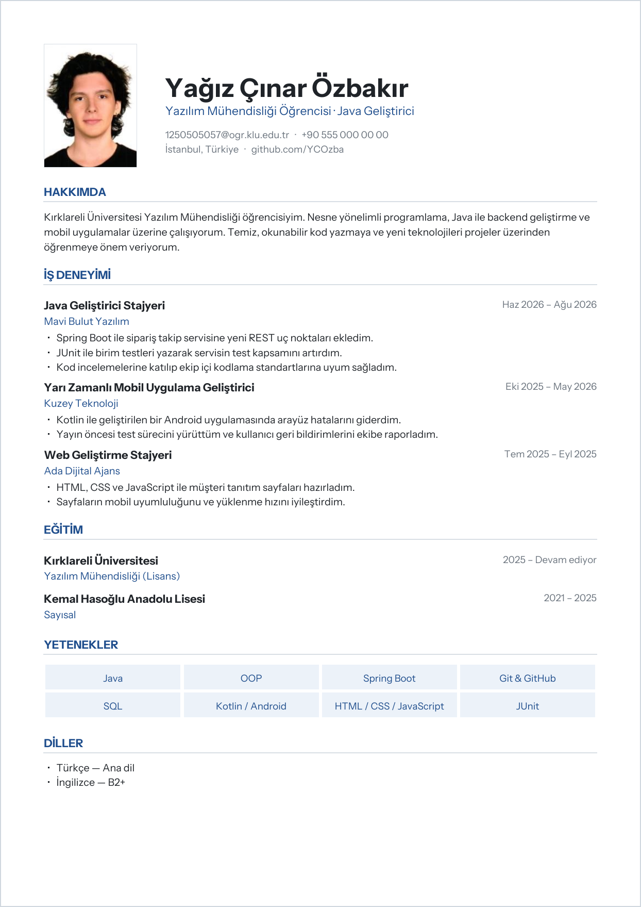
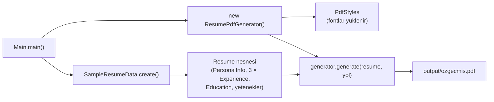
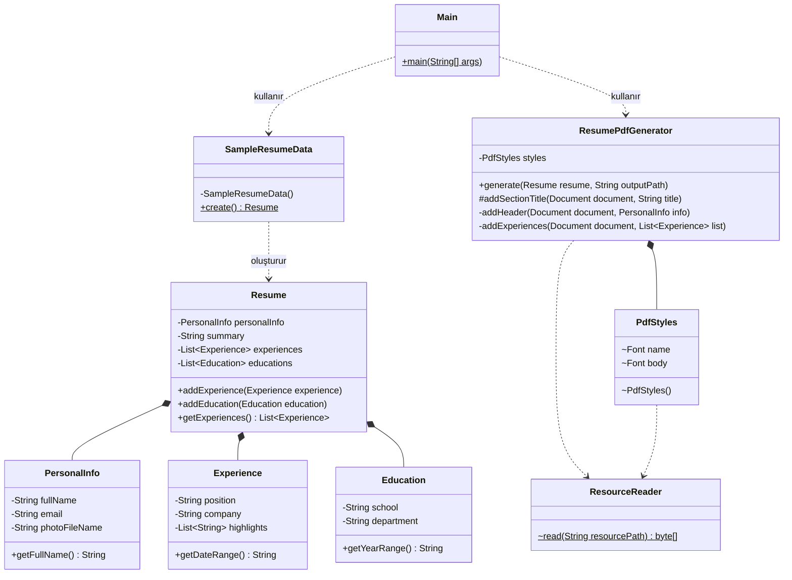

# Java PDF Özgeçmiş Oluşturucu


Java ile yazılmış, arayüzü olmayan (konsol tabanlı) bir uygulama. Program çalıştırıldığında, kod içinde tanımlanan özgeçmiş bilgilerini alır ve **fotoğraflı, A4 boyutunda bir PDF özgeçmiş** oluşturur.

Proje, ders ödevi kapsamında hazırlanmıştır. Kodun yanında; kullanılan sınıflar ve nesneler, nesne yaşam döngüsü ve erişim belirleyiciler de bu dosyada açıklanmıştır.

<p align="center">
  
</p>

> Oluşturulan örnek PDF: [`docs/ornek-ozgecmis.pdf`](docs/ornek-ozgecmis.pdf)

---

## İçindekiler

- [Özellikler](#özellikler)
- [Kullanılan Teknolojiler](#kullanılan-teknolojiler)
- [Proje Yapısı](#proje-yapısı)
- [Kurulum ve Çalıştırma](#kurulum-ve-çalıştırma)
- [Program Akışı](#program-akışı)
- [Sınıf Diyagramı](#sınıf-diyagramı)
- [Kullanılan Sınıflar ve Nesneler](#kullanılan-sınıflar-ve-nesneler)
- [Nesne Yaşam Döngüsü](#nesne-yaşam-döngüsü)
- [Erişim Belirleyiciler](#erişim-belirleyiciler)
- [Yapay Zekâ Kullanımı](#yapay-zekâ-kullanımı)
- [Lisanslar](#lisanslar)

---

## Özellikler

- Fotoğraflı, tek sayfalık A4 PDF özgeçmiş üretir.
- Kişisel bilgiler, hakkımda, **3 iş deneyimi**, eğitim, yetenekler ve diller bölümlerini içerir.
- PDF oluşturma işlemi `main` metodunda değil, ayrı bir sınıfta (`ResumePdfGenerator`) yapılır.
- Veri (model), örnek bilgiler (data) ve PDF çizimi (pdf) ayrı paketlerde tutulur.
- Font PDF'in içine gömülür; Türkçe karakterler (ş, ğ, ı, İ, ç, ö, ü) her cihazda doğru görünür.
- Arayüz gerektirmez; tek komutla çalışır.

## Kullanılan Teknolojiler

| Teknoloji | Sürüm | Kullanım Amacı |
|---|---|---|
| Java (JDK) | 21 | Uygulama dili |
| Maven | 3.9+ | Bağımlılık yönetimi ve derleme |
| [OpenPDF](https://github.com/LibrePDF/OpenPDF) | 3.0.5 | PDF dosyası oluşturma |
| [Instrument Sans](https://github.com/Instrument/instrument-sans) | — | PDF'e gömülen yazı tipi (Türkçe karakter desteği) |

**Neden OpenPDF?** Java'nın kendi standart kütüphanesinde PDF oluşturma özelliği yoktur. OpenPDF; paragraf, tablo, görsel gibi hazır PDF bileşenleri sunan, ücretsiz ve açık kaynaklı (LGPL/MPL) bir kütüphanedir. Daha alt seviye bir alternatif olan Apache PDFBox'ta her metnin konumunu koordinatla vermek gerekirken, OpenPDF'te içerik yukarıdan aşağıya otomatik olarak yerleşir. Bu da özgeçmiş gibi metin ağırlıklı bir belge için kodu çok daha sade hale getirir.

## Proje Yapısı

```
java-pdf-cv-generator/
├── pom.xml                                  # Maven ayarları ve bağımlılıklar
├── docs/
│   ├── ornek-ozgecmis.pdf                   # Programın ürettiği örnek çıktı
│   └── onizleme.png                         # README'deki önizleme görseli
└── src/main/
    ├── java/com/cinar/cv/
    │   ├── Main.java                        # Giriş noktası, işi diğer sınıflara devreder
    │   ├── model/                           # Veriyi temsil eden sınıflar
    │   │   ├── PersonalInfo.java
    │   │   ├── Experience.java
    │   │   ├── Education.java
    │   │   └── Resume.java
    │   ├── data/
    │   │   └── SampleResumeData.java        # Özgeçmişte kullanılan bilgiler
    │   └── pdf/                             # PDF ile ilgili her şey
    │       ├── ResumePdfGenerator.java      # PDF'i oluşturan sınıf
    │       ├── PdfStyles.java               # Renk ve yazı tipleri
    │       └── ResourceReader.java          # Fotoğraf ve font dosyalarını okur
    └── resources/
        ├── photo.jpg                        # Özgeçmiş fotoğrafı
        └── fonts/                           # Gömülen yazı tipi ve lisansı
```

## Kurulum ve Çalıştırma

### Gereksinimler

- **JDK 21** veya üzeri
- **Maven** ya da Maven'ı içinde barındıran bir IDE (IntelliJ IDEA gibi)

### Adımlar

```bash
# 1. Projeyi klonla
git clone https://github.com/YCOzba/java-pdf-cv-generator.git
cd java-pdf-cv-generator

# 2. Derle ve çalıştır
mvn compile exec:java
```

Program çalıştıktan sonra PDF şu konumda oluşur:

```
output/ozgecmis.pdf
```

**IntelliJ IDEA ile:** Projeyi `File → Open` ile açın, Maven bağımlılıklarının inmesini bekleyin, ardından `Main.java` dosyasındaki ▶ butonuna basın.

> **"The file in the editor is not runnable" uyarısı alırsanız:** Proje Maven projesi olarak yüklenmemiştir. `pom.xml` dosyasına sağ tıklayıp **Add as Maven Project** seçin (ya da Maven panelinden **Reload All Maven Projects**), ardından `File → Project Structure → SDK` kısmından JDK 21 veya üzerini seçin.

### Kendi Özgeçmişini Oluşturmak

1. `src/main/java/com/cinar/cv/data/SampleResumeData.java` dosyasındaki bilgileri düzenle.
2. `src/main/resources/photo.jpg` dosyasını kendi fotoğrafınla değiştir (dosya adı aynı kalmalı).
3. Programı tekrar çalıştır.

## Program Akışı



1. `Main`, örnek verileri `SampleResumeData.create()` ile alır ve bir `Resume` nesnesi elde eder.
2. `Main`, bir `ResumePdfGenerator` nesnesi oluşturur. Bu nesne oluşurken fontlar `PdfStyles` içinde yüklenir.
3. `generate()` metodu PDF belgesini açar, bölümleri sırayla (başlık, hakkımda, deneyim, eğitim, yetenekler, diller) ekler ve belgeyi kapatır.

## Sınıf Diyagramı



Diyagramdaki semboller erişim belirleyicileri gösterir: `+` public, `-` private, `#` protected, `~` default (package-private). Altı çizili üyeler `static`'tir. İçi dolu elmas (`*--`) kompozisyonu, yani bir nesnenin diğerlerini parçası olarak barındırdığını gösterir.

## Kullanılan Sınıflar ve Nesneler

### Projede yazılan sınıflar

| Sınıf | Paket | Görevi | Neden kullanıldı? |
|---|---|---|---|
| `Main` | `cv` | Programın giriş noktası | Sadece nesneleri oluşturup işi devreder; PDF kodu burada yer almaz. |
| `PersonalInfo` | `model` | Ad, unvan, iletişim, fotoğraf bilgisi | Kişisel bilgileri tek bir nesnede toplar. |
| `Experience` | `model` | Tek bir iş deneyimi | Aynı sınıftan 3 ayrı nesne üretilerek 3 iş deneyimi oluşturulur. |
| `Education` | `model` | Tek bir eğitim bilgisi | Okul, bölüm ve yılları bir arada tutar. |
| `Resume` | `model` | Özgeçmişin tamamı | Diğer model nesnelerini içinde barındırır (kompozisyon). |
| `SampleResumeData` | `data` | Özgeçmiş bilgilerini oluşturur | Veriyi koddan ayırır; bilgileri değiştirmek için tek dosyaya bakmak yeterlidir. |
| `ResumePdfGenerator` | `pdf` | `Resume` nesnesini PDF'e dönüştürür | PDF ile ilgili tüm işi `main`'den ayrı, tek bir sınıfta toplar. |
| `PdfStyles` | `pdf` | Renkler ve yazı tipleri | Tasarım ayarlarını tek yerde tutar; renk değiştirmek için sadece bu sınıf düzenlenir. |
| `ResourceReader` | `pdf` | Fotoğraf ve font dosyasını okur | Dosya okuma kodunun tekrar yazılmasını önler. |

### Kullanılan hazır sınıflar (Java ve OpenPDF)

| Sınıf | Kaynak | Ne işe yarar? |
|---|---|---|
| `Document` | OpenPDF | PDF belgesinin kendisi. `open()` ile açılır, içerik eklenir, `close()` ile kapatılır. |
| `PdfWriter` | OpenPDF | `Document`'e eklenen içeriği dosyaya PDF formatında yazar. |
| `Paragraph` / `Phrase` | OpenPDF | Metin blokları. `Paragraph` yeni satırdan başlar, `Phrase` tablo hücrelerinde kullanılır. |
| `PdfPTable` / `PdfPCell` | OpenPDF | Yan yana yerleşim gereken yerlerde kullanılır (fotoğraf + bilgiler, unvan + tarih, yetenek kutucukları). |
| `Image` | OpenPDF | Profil fotoğrafını PDF'e ekler. |
| `Font` / `BaseFont` | OpenPDF | Yazı tipi, boyut ve renk. `BaseFont` TTF dosyasını PDF'e gömer. |
| `Color` | `java.awt` | Başlık, metin ve çizgi renkleri. |
| `List`, `ArrayList` | `java.util` | Birden fazla deneyim, eğitim ve yeteneği tutmak için. |
| `Path`, `Files` | `java.nio.file` | Çıktı klasörünü oluşturmak ve PDF dosyasını açmak için. |
| `InputStream` / `OutputStream` | `java.io` | Kaynak dosyaları okumak ve PDF'i diske yazmak için. |

## Nesne Yaşam Döngüsü

Java'da bir nesne üç aşamadan geçer: **oluşturulur**, **kullanılır** ve artık ona ulaşan hiçbir referans kalmadığında **Garbage Collector (Çöp Toplayıcı)** tarafından bellekten silinir. Projede bu döngü şöyle işler:

**1. Oluşturma:** `new` anahtar kelimesi bellekte yer açar ve constructor çalışır.

```java
Experience experience = new Experience("Java Geliştirici Stajyeri", "Mavi Bulut Yazılım",
        "Haz 2026", "Ağu 2026", List.of("..."));
```

Alanlar `final` olduğu için değerleri yalnızca constructor içinde bir kez atanır; nesne oluştuktan sonra değiştirilemez (immutable).

**2. Kullanım:** Nesne, metotları üzerinden kullanılır. Örneğin `ResumePdfGenerator`, `experience.getPosition()` ile pozisyonu okuyup PDF'e yazar.

**3. Kaynakların kapatılması:** Dosya gibi işletim sistemi kaynaklarını tutan nesnelerin işi bitince kapatılması gerekir. Bunun için `try-with-resources` kullanılmıştır:

```java
try (OutputStream out = Files.newOutputStream(path)) {
    PdfWriter.getInstance(document, out);
    document.open();
    // ... bölümler eklenir ...
    document.close();
} // out burada otomatik olarak kapatılır, hata oluşsa bile
```

**4. Bellekten silinme:** `main` metodu bittiğinde `resume` ve `generator` değişkenleri ortadan kalkar. Bu nesnelere ulaşan referans kalmadığı için Garbage Collector onları uygun bir zamanda bellekten temizler. Java'da nesneyi programcı silmez, bu iş otomatik yapılır.

## Erişim Belirleyiciler

| Belirleyici | Erişebilen | Projedeki kullanımı |
|---|---|---|
| `public` | Her yer | `ResumePdfGenerator.generate()`, model sınıflarının constructor ve getter metotları |
| `protected` | Aynı paket + alt sınıflar | `ResumePdfGenerator.addSectionTitle()`: farklı tasarımda bir alt sınıf başlık stilini değiştirebilsin diye |
| *(default)* | Yalnızca aynı paket | `PdfStyles` ve `ResourceReader` sınıfları: sadece `pdf` paketi içinde kullanılır, dışarıya kapalıdır |
| `private` | Yalnızca aynı sınıf | Model sınıflarının tüm alanları, `ResumePdfGenerator`'ın bölüm çizen yardımcı metotları, `SampleResumeData`'nın constructor'ı |

**Kapsülleme (encapsulation):** Model sınıflarındaki tüm alanlar `private`'tır; dışarıdan yalnızca `public` getter metotlarıyla okunabilir. `Resume` sınıfı listeleri doğrudan vermek yerine `Collections.unmodifiableList()` ile salt-okunur bir görünüm döndürür. Böylece dışarıdan `getExperiences().clear()` gibi bir çağrıyla veri silinemez.

**`private` constructor:** `SampleResumeData` yalnızca `static create()` metodu sunan bir yardımcı sınıftır. Constructor'ı `private` olduğu için bu sınıftan `new` ile nesne oluşturulamaz.

## Yapay Zekâ Kullanımı

Bu proje, **Claude** (Anthropic) yapay zekâ asistanı ile birlikte geliştirilmiştir.

- **Planlama:** Ödev gereksinimleri Claude ile birlikte incelendi; paket yapısı (model / data / pdf) ve sınıfların görevleri bu aşamada belirlendi.
- **Kod yazımı:** Sınıfların ilk hali Claude tarafından yazıldı. Kodun sade ve açıklanabilir olması, her sınıfın tek bir işten sorumlu olması özellikle istendi.
- **Teknik kararlar:** OpenPDF'in varsayılan fontları Türkçe karakterleri desteklemediği için Türkçe destekli bir font PDF'e gömüldü (`IDENTITY_H`, `EMBEDDED`). OpenPDF 3.x sürümünde paket adının `com.lowagie` yerine `org.openpdf` olduğu ve en az Java 21 gerektirdiği, kütüphanenin içeriği incelenerek tespit edildi ve kod buna göre düzenlendi.
- **Kurulum sorunları:** Claude'un çalışma ortamı Maven deposuna erişemediği için OpenPDF `.jar` dosyası geliştirici tarafından sağlandı. IntelliJ'de projenin Maven projesi olarak yüklenmemesinden kaynaklanan "not runnable" sorunu, `pom.xml` Maven projesi olarak eklenerek çözüldü.
- **İnceleme ve öğrenme:** Kod teslimden önce Claude ile sınıf sınıf incelendi; nesne yaşam döngüsü ve erişim belirleyicilerin projede nerede kullanıldığı bu süreçte çıkarıldı.

## Lisanslar

- **OpenPDF:** LGPL 2.1 / MPL 2.0
- **Instrument Sans** yazı tipi: SIL Open Font License 1.1 ([`src/main/resources/fonts/OFL.txt`](src/main/resources/fonts/OFL.txt))

---

**Geliştirici:** Yağız Çınar Özbakır, Kırklareli Üniversitesi Yazılım Mühendisliği
